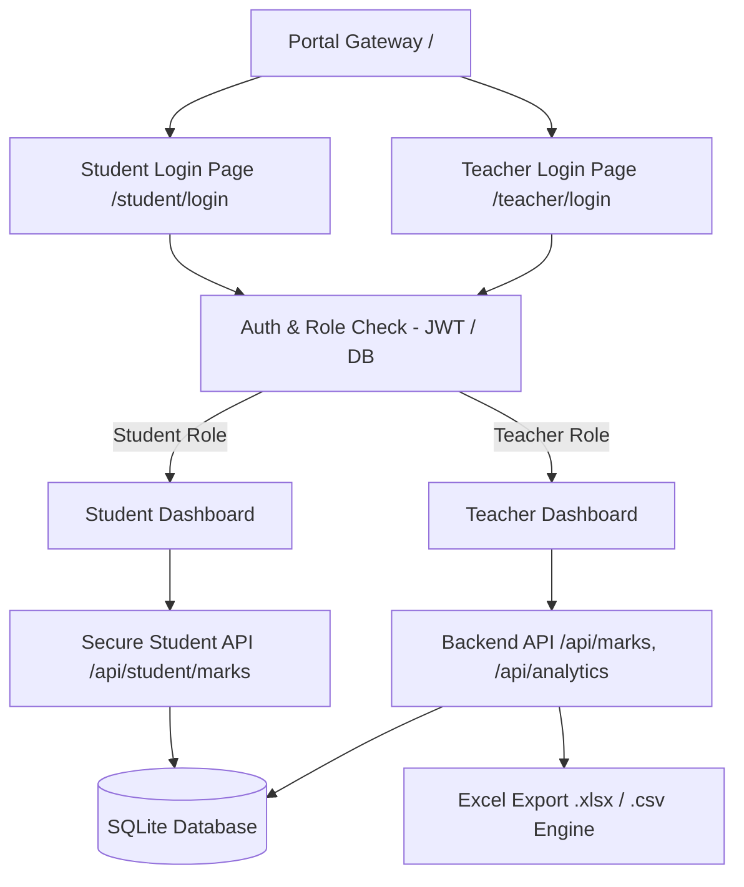

# ⚡ Student Performance Analysis Portal — Flashlite Architecture

A modern, fullstack web application for student performance analysis, gradebook management, and academic insights. Built to faithfully implement the system architecture specified in `Student_Portal_Architecture.pdf` and the data analytics dataset from `README.pdf`.

---

## 🌟 Key Highlights & Features

### 1. Flashlite UI Design System
- **Dynamic Spotlight Beam Cursor:** An interactive luminous radial beam (`--beam-color`) tracks your cursor across cards and glassmorphic surfaces in real time.
- **Torch Theme Controller:** Switch between 4 distinct beam colors (**Cyber Cyan**, **Bio Emerald**, **Neon Violet**, **Solar Amber**) or toggle the beam with `Alt + F`.
- **Glassmorphic Aesthetic:** Deep space backdrops (`#080b12`), translucent blurred surfaces (`backdrop-filter: blur(20px)`), glowing border accents, and responsive layout.

### 2. Strict Role Segregation & Access Security
- **Two Separate Login Pages:**
  - 👨‍🏫 **Teacher Portal (`/teacher/login`):** Exclusively accepts faculty accounts. If a student tries to sign in here, access is rejected with a clear role-mismatch notice.
  - 🎓 **Student Portal (`/student/login`):** Exclusively accepts student accounts (login via Student ID or Email). If faculty attempts to log in here, access is rejected.
- **Role Verification on Every API Request:** Backend JWT and database validation ensures students cannot access upload endpoints, class-wide records, or another student's marks.
- **Strict Read-Only Privacy for Students:** The student API only queries rows matching `req.user.studentId`.

### 3. Real-Time Excel Analytics & Formula Alignment
Calculations match the `README.pdf` benchmark dataset:
- **Passing Criterion:** *A student must score at least 40 marks in every subject to pass.* The backend calculates the `Result` automatically; it is never entered by hand.
- **Class Metrics:**
  - **Cohort Size:** 10 Students (Aarav, Diya, Rahul, Priya, Arjun, Ananya, Rohan, Sneha, Karan, Meera)
  - **Overall Average:** `69.73%` across all subject marks
  - **Subject Averages:** Mathematics: `68.1%`, Science: `70.0%`, English: `71.1%`
  - **Highest Score:** `96` (Sneha - Science)
  - **Lowest Score:** `30` (Karan - Mathematics)
  - **Pass Percentage:** `80%` (8 Passed, 2 Failed: Priya and Karan)
- **Live Excel Export:** Generates multi-sheet `.xlsx` files (`Student_Performance_Analysis.xlsx`) and CSV on demand.
- **Bulk Spreadsheet Import:** Drag-and-drop Excel (`.xlsx`, `.xls`) or CSV files with real-time numeric validation (0–100 range checks).

---

## 🏗️ System Architecture



---

## 🚀 Quick Start Guide

### Prerequisites
- Node.js (v18+ or v24+)
- npm

### 1. Installation
The dependencies are already installed. If needed, install via:
```bash
npm install
```

### 2. Start the Server
```bash
npm start
```
or with automatic file watching:
```bash
npm run dev
```

The application will start on: **`http://localhost:3000`**

---

## 🔑 Preconfigured Demo Accounts

For easy grading and evaluation, both login pages include **1-Click Auto-fill buttons**:

| Role | Name / Student ID | Email / Identifier | Password | Academic Status |
| :--- | :--- | :--- | :--- | :--- |
| **Teacher** | Prof. Sarah Vance | `teacher@portal.edu` | `teacher123` | Full Access & Analytics |
| **Student** | #101 Aarav | `101` or `aarav@student.edu` | `student123` | **Passed** (Avg: 84.33%) |
| **Student** | #102 Diya | `102` or `diya@student.edu` | `student123` | **Passed** (Avg: 91.67%) |
| **Student** | #104 Priya | `104` or `priya@student.edu` | `student123` | **Failed** (Avg: 37.67%, Math: 35, Eng: 38) |
| **Student** | #108 Sneha | `108` or `sneha@student.edu` | `student123` | **Passed / Top Rank** (Avg: 94.33%, Score: 96) |
| **Student** | #109 Karan | `109` or `karan@student.edu` | `student123` | **Failed** (Avg: 35.67%, Math: 30, Sci: 35) |

---

## 📁 Project Structure

```
student/
├── server/
│   ├── app.js                 # Express server configuration & route definitions
│   ├── db.js                  # Native SQLite database, schema migrations & seed data
│   ├── auth.js                # JWT tokens & role verification middleware
│   ├── analytics.js           # Statistical engine, pass/fail rules & Excel generator
│   └── routes/
│       ├── auth.routes.js     # Segregated Teacher and Student authentication
│       ├── marks.routes.js    # Marks CRUD, Excel upload/export & student self-view
│       ├── attendance.routes.js # Attendance recording & student attendance view
│       └── analytics.routes.js# Class statistics and student benchmark comparisons
├── public/
│   ├── index.html             # Gateway landing page with Flashlite spotlight
│   ├── teacher-login.html     # Dedicated Teacher Login (Teacher accounts only)
│   ├── student-login.html     # Dedicated Student Login (Student accounts only)
│   ├── teacher-dashboard.html # Faculty Control Center (Gradebook, KPIs, Charts, Uploads)
│   ├── student-dashboard.html # Strict Student Portal (Personal marks & benchmarks)
│   ├── css/
│   │   ├── style.css          # Design system, CSS variables & spotlight engine
│   │   └── components.css     # Glassmorphic cards, tables, badges, tabs & modals
│   └── js/
│       ├── flashlight.js      # Dynamic mouse spotlight tracker & theme switcher
│       ├── api.js             # Centralized JWT client & toast notification system
│       ├── teacher.js         # Teacher dashboard logic & Chart.js visualizations
│       └── student.js         # Student dashboard logic & personal benchmarks
├── package.json
└── README.md
```
